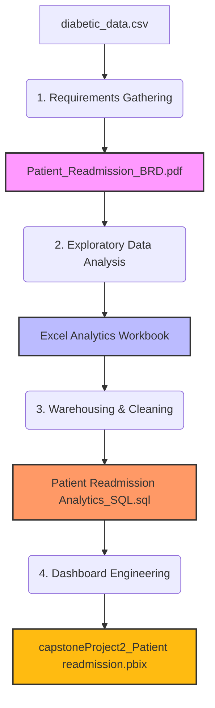

# ReadmitGuard-Hospital-Patient-Readmission-Analytics
An end-to-end healthcare data analytics portfolio project tracking 30-day patient readmission risks. This project incorporates business analysis, database warehousing, and interactive dashboarding to support clinical resource decisions.

## 📊 Project Workflow

---

## 🖥️ Interactive Dashboard Preview
Here is a snapshot of the final interactive Power BI dashboard interface:

---

## 📁 Repository Portfolio Contents

Click the links below to navigate through the specific project assets uploaded to this repository:

* 📄 **[Business Requirements Document (BRD)](./Patient_Readmission_BRD.pdf)** - Outlines project scope, stakeholders (Project Sponsor: Dr. Amanda Clark), critical HIPAA compliance constraints, and operational goals.
* 💾 **[SQL Database Scripts](./Patient%20Readmission%20Analytics_SQL.sql)** - Relational schema setups, historical data merges, and multi-metric aggregation queries.
* 📉 **[Power BI Dashboard File (.pbix)](./capstoneProject2_Patient%20readmission.pbix)** - Final interactive reporting model utilizing advanced DAX measures to highlight top readmission risk categories.

---
*Developed as a Capstone Portfolio Project by Divya Jayapall — July 2026.*

